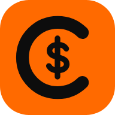
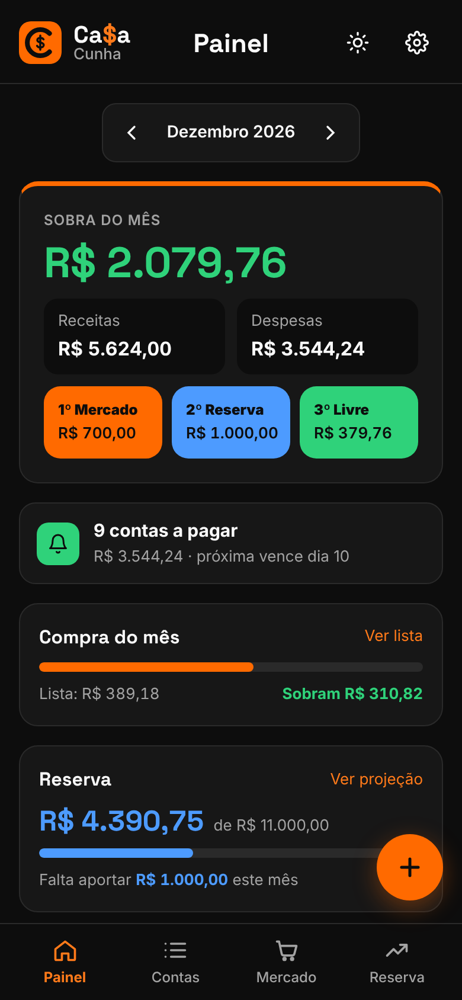
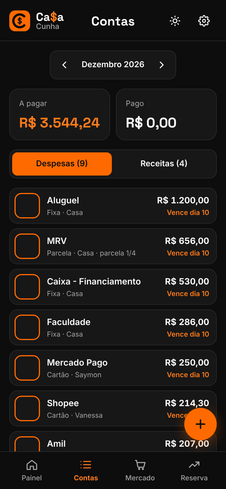
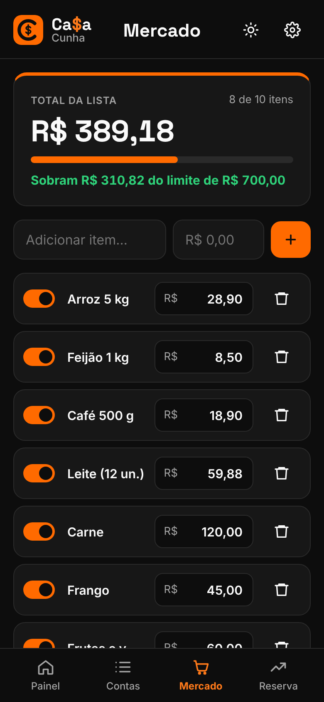
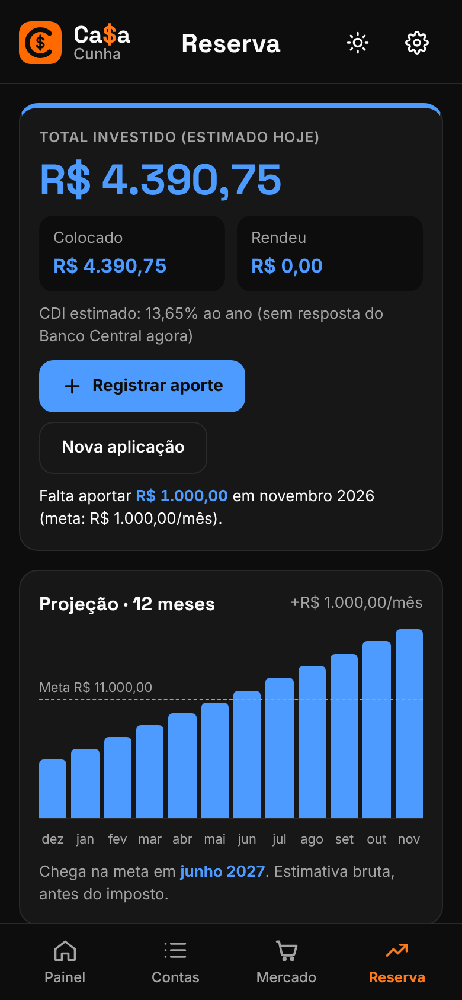
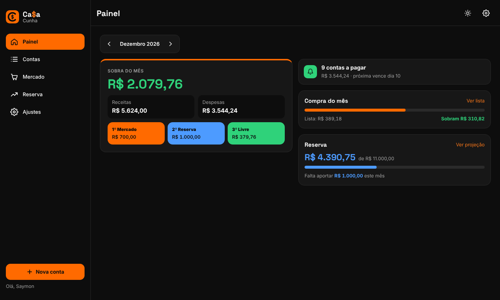

<h1 align="center">Ca$a</h1>

<b>As contas da família num lugar só.</b> O que vence, o que sobra e o que está investido. O que um lança, o outro vê na hora.

  
  
  
  

---

## O que ele faz

- **Painel do mês:** quanto sobra (em verde), dividido em 1º mercado, 2º reserva e 3º livre.
- **Contas:** fixas, cartões, parcelas e receitas. As que se repetem aparecem sozinhas nos próximos meses; parcelas contam até acabar. Um toque marca como pago.
- **Vencimentos:** cada conta tem o dia de vencimento; o app avisa o que vence em até 3 dias e o que está atrasado.
- **Lista do mercado:** liga e desliga itens, troca o preço e vê na hora quanto sobra do limite do mês.
- **Reserva e investimentos (em azul):** registre os aportes; o rendimento é estimado com o CDI do dia, direto do Banco Central. Projeção de 12 meses até a meta.
- **Família:** cada casa cria a sua com o sobrenome ("Ca$a Cunha") e convida os outros com um código.
- **Funciona no PC e no celular:** no navegador ou instalado na tela inicial (Android e iPhone). Tema escuro e claro.
- **Privacidade:** cada família só enxerga os próprios dados; qualquer pessoa pode excluir a própria conta pelo app.

## Experimente sem instalar nada

Baixe o projeto e dê dois cliques no `index.html`. Sem configuração, ele abre em **modo demonstração**, com dados de exemplo guardados só no seu navegador.

## Monte a Ca$a da sua família (grátis, uns 20 minutos)

O passo a passo completo, com cada clique, está em **[PUBLICAR.md](PUBLICAR.md)**. Em resumo:

1. **Supabase** (banco de dados): crie um projeto e rode `supabase/schema.sql` no SQL Editor.
2. **Netlify** (site): importe este repositório (ou arraste a pasta) e cadastre `SUPABASE_URL` e `SUPABASE_ANON_KEY`.
3. Abra o endereço, crie sua conta e a sua família, e mande o código de convite para quem mora com você.

## Como é feito

HTML, CSS e JavaScript puros, sem etapa de build. Banco, login e atualização ao vivo pelo [Supabase](https://supabase.com); taxa do CDI pela [API do Banco Central (SGS)](https://dadosabertos.bcb.gov.br/dataset/12-taxa-de-juros---selic).

| Pasta / arquivo | Para quê |
|---|---|
| `index.html`, `js/app.js`, `css/styles.css` | O app (telas, regras e visual) |
| `js/config.js` | Endereço e chave pública do seu Supabase |
| `supabase/schema.sql` | Tabelas, segurança por família, convite e exclusão de conta |
| `supabase/seed-familia-cunha.sql` | Exemplo de como lançar contas iniciais por SQL |
| `scripts/gerar-config.js`, `netlify.toml` | Preenchem o `config.js` a partir das variáveis do Netlify |
| `sw.js`, `manifest.webmanifest`, `icons/` | Instalar no celular como app |
| `privacidade.html` | Política de privacidade e termos de uso |

## Licença

[MIT](LICENSE): pode usar, mudar e distribuir, mantendo o aviso de copyright.
